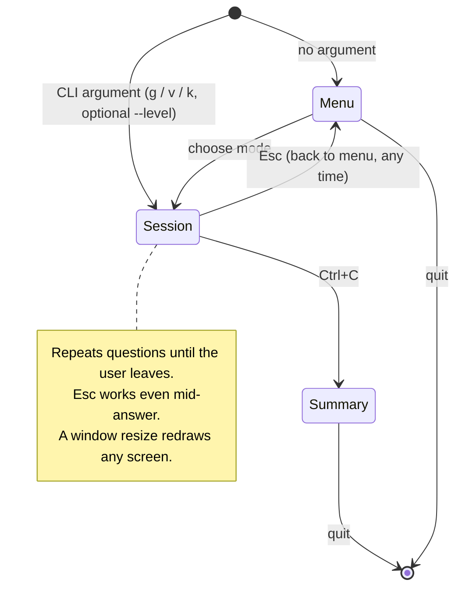
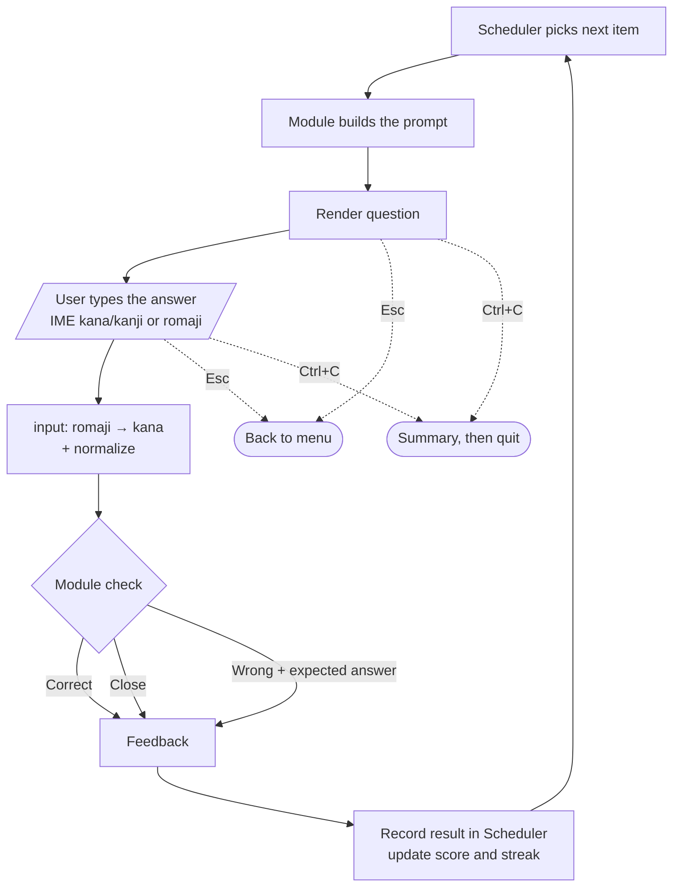
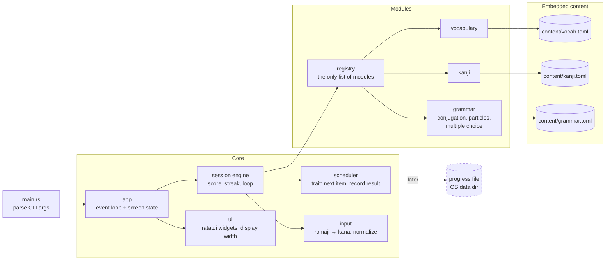
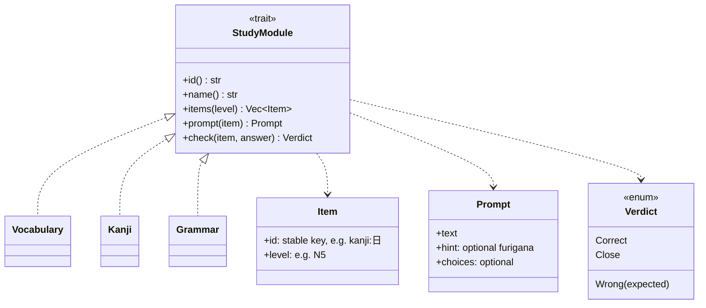

<!--
SPDX-License-Identifier: GPL-3.0-or-later
Copyright (C) 2026 PandaCubGames
-->

# Architecture (draft)

> **Status: planned.** None of this exists in code yet. These diagrams describe the
> intended design and will change as it gets built.

The diagrams use [Mermaid](https://mermaid.js.org/), which GitHub renders directly.
To edit one visually, paste its code into Excalidraw (*More tools → Mermaid to Excalidraw*).

## Core idea

You pick a study mode (Grammar, Vocabulary or Kanji) and keep answering questions
until you quit. **One shared session engine runs the loop.** Each module only answers
two things: *what's the next item?* and *is this answer correct?* Input handling,
romaji conversion, scoring and the quit key live in one place, and adding a module
doesn't touch the others.

## 1. Screen flow

The app is one TUI event loop (draw → read key → update). "Studying" is a screen
state, not a blocking loop, so resizes and quit keys always work.

## 2. The study loop inside a session

**Leaving a session:** `Esc` returns to the menu at any time, even while typing
an answer (the unfinished answer is dropped). `Ctrl+C` shows the session summary
and quits the app. Letter keys like `q` don't quit, because they can be part of a
typed answer.

## 3. Components

- **Scheduler:** the first version is a shuffle that shows missed items more often,
  in memory only. Spaced repetition and saved progress come later (dashed).
- **Content** is embedded in the binary with `include_str!`, so the release stays
  a single file. Sources and licenses go in `ATTRIBUTION.md`.

## 4. Module contract

**Adding a module** = one new file in `modules/`, one line in the registry, and one
content file. Nothing else changes.

## Build order

1. Session engine, Menu → Session → Summary, romaji input, and **Vocabulary**.
2. **Kanji** (reuses the typed-answer flow: reading / meaning).
3. **Grammar** (exercise types: conjugation, particle fill-in, multiple choice).
4. Saved progress and spaced repetition.
