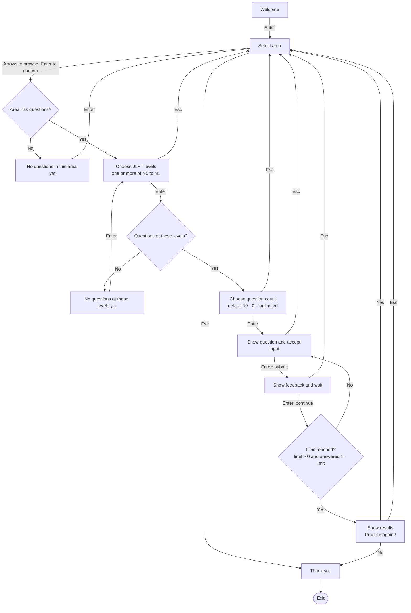
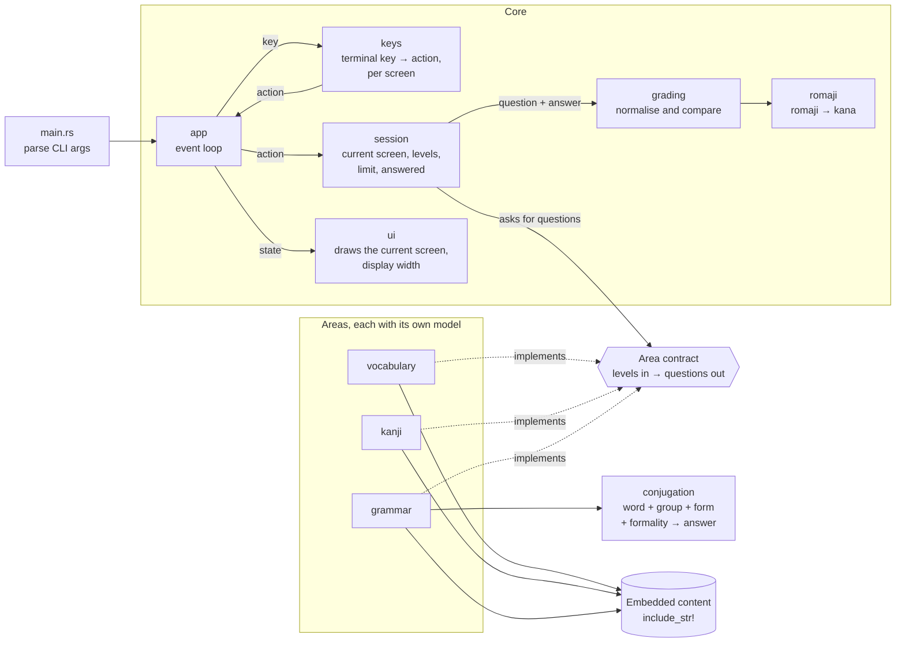

<!--
SPDX-License-Identifier: GPL-3.0-or-later
Copyright (C) 2026 PandaCubGames
-->

# Architecture (draft)

> **Status: mostly planned.** Only the core loop exists in code: `app`, `keys`, `session`
> and `ui`, showing a placeholder Welcome screen. Everything else here is still planned.
> These diagrams describe the intended design and will change as it gets built.

The diagrams use [Mermaid](https://mermaid.js.org/), which GitHub renders directly.
To edit one visually, paste its code into Excalidraw (*More tools → Mermaid to Excalidraw*).

## Core idea

The app is for **practice**. You pick an area (Vocabulary, Kanji or Grammar), pick the
JLPT levels you want, choose how many questions you want, and answer them one by one.
Each answer gets feedback, and at the end you see your results and can practise again.

Two words are used with a fixed meaning throughout this document:

- **Area:** one of the three things you can practise: Vocabulary, Kanji or Grammar.
- **Category:** a part of speech (noun, verb, adjective and so on), used inside the
  Vocabulary and Grammar models.

## 1. Screen flow



Welcome and Thank you are ordinary screens at the start and the end. There is no
fixed header or footer, and no separate logout.

## 2. Decisions

### Scope
- **Practice only for now.** A broader study system (saved history, spaced repetition,
  detailed grading and explanation rules) is out of scope.

### Areas
- Vocabulary, Kanji and Grammar each have **their own model and their own database**.
  There are **no links** between entries of different areas.
- **Empty area:** it can still be selected. It shows "No questions in this area yet",
  and Enter goes back to area selection.

### Levels
- Every entry carries one or more JLPT levels (see [Data models](#3-data-models)).
- **The level picker is part of the first version.** It comes after the area and before
  the question count, and lets you choose one or more levels.
- An entry is practised when it has **any** of the chosen levels.

### Question count
- Chosen before practice starts. The default is `10`, and `0` means **unlimited**.
- Stored as a `u8`. Input is **clamped**, not rejected: anything above `255` becomes
  `255`, and anything below `0` becomes `0` (unlimited).
- The session ends when `limit > 0 && answered >= limit`. Unlimited mode never counts
  down, so an unsigned zero is never decremented.

### Questions
- Each entry produces questions from two sources:
  - **Template questions**, generated by the app from the entry's fields.
  - **Custom questions**, written by hand on the entry, each with its own accepted answers.
- **Both are mixed.** An entry's custom questions join its template questions in one pool.
  A custom question never switches the templates off.
- **Picking the next question:** pick an entry at random, then one of its questions at
  random. An entry is not repeated until every entry in the selection has been seen.

### Answering and feedback
- **Input rules belong to the kind of exercise**, not to each exercise and not to one
  shared conversion step:
  - Japanese: typed in any script (see below).
  - Meaning: plain text, never converted to kana.
  - Choice: picked with a selection control. **Not in the first version**, where every
    answer is typed.
- Enter submits the answer. **Feedback is a waiting step:** it stays until the next Enter,
  including after the last question, before the results appear.
- Each submitted answer is **counted once**, correct or not. Continuing from feedback
  doesn't count it again.

### Checking answers
- **Japanese answers don't depend on the script.** Romaji and katakana are both turned
  into hiragana before comparing, and the written form with kanji is accepted as it is.
  For `高い`, all of `takai`, `タカイ`, `たかい` and `高い` are correct.
- **An answer that repeats what the question already shows is never accepted.**
  "How do you read 食?" does not accept `食`.
- **English answers** ignore capital letters, extra spaces and a leading "to", "a", "an"
  or "the". "Eat" and "to eat" both match "to eat".
- **When several entries fit an English prompt**, any entry of that area whose meaning
  matches is accepted. `高い` is never marked wrong for "tall" because another word was
  the one drawn.

### Keys
- Keys depend on the current screen:
  - Area selection: arrows and Enter.
  - Level picker: arrows to move, a key to tick or untick a level, Enter to confirm.
  - Question: input suited to the exercise kind.
  - Feedback: waits for Enter.
- **Esc:**
  - While answering, on feedback, on the level picker, on the question count and on
    results: goes back to area selection. An unfinished answer is dropped and not counted
    as a mistake.
  - On area selection: goes to Thank you, then the app exits.
- **Practise again:** Yes goes back to area selection (so you can pick another area).
  No goes to Thank you, then exits.
- Terminal key handling is kept separate from session actions and drawing, so the
  screen changes can be tested without an interactive terminal.

## 3. Data models

The entries below are laid out for reading. They are not a file format; that is still
open (see [Still open](#6-still-open)).

### Shared conventions

- **`id`:** a unique identifier (a UUID). It is assigned once, when the entry is added to
  its database, and is stored with the entry. It never changes afterwards.
- **`jlpt_levels`:** a list with one or more of `N5`, `N4`, `N3`, `N2`, `N1`. When none
  is given, the default is `[N5]`.
- **Custom questions:** an optional list on an entry. Each has a question text and a list
  of accepted answers.
- **Rules that span several fields are tested.** Where the fields alone can't prevent a
  wrong entry, a check runs when an entry is added and a test runs over the whole
  database.

### Categories

Vocabulary and Grammar share one list of categories. A verb or an adjective carries its
group **inside** the category, as a single value, so a pair like "noun, godan" can't be
written at all.

| Category | Groups |
|---|---|
| Noun | none |
| Verb | Ichidan (ru), Godan, Irregular |
| Adjective | I, Na |
| Particle | none |
| Conjunction | none |
| Adverb | none |
| Pronoun | none |
| Interjection | none |
| Prenominal modifier | none |

Auxiliary verbs are Grammar content, not a tenth category.

### Vocabulary

| Field | Rule |
|---|---|
| `id` | See shared conventions. |
| `reading` | A list of kana readings, at least one. |
| `kanji` | Optional written form. Not every word has one. |
| `category` | One value from the table above. |
| `jlpt_levels` | See shared conventions. |
| `description` | Optional. A loose explanation of the word's overall sense, covering all its meanings. |
| `meanings` | A list, at least one. |

Each meaning has:

| Field | Rule |
|---|---|
| `text` | One plain text, for example "expensive". |
| `examples` | A list of example sentences for this meaning. |
| `custom_questions` | Optional. Custom questions about this meaning. |

**Grouping meanings:** different meanings of one word share an entry when they have the
same set of JLPT levels. When the sets differ, they are separate entries with different
ids.

Example:

```text
id:           7e4a1c93-5d2f-4b86-a0c7-3f9e8d1b6a42
reading:      [たかい]
kanji:        高い
category:     Adjective(I)
jlpt_levels:  [N5]
description:  Something that is more: higher up, bigger, or costing more.
meanings:
  - text:     high
    examples: [ あの山は高い。 ]
  - text:     tall
    examples: [ 兄は背が高い。 ]
  - text:     expensive
    examples: [ このかばんは高い。 ]
    custom_questions:
      - question: Which adjective is the opposite of 安い?
        answers:  [高い, たかい]
```

Questions it produces:

| Source | Prompt | Accepted |
|---|---|---|
| Template, Japanese → English | What does 高い mean? | high, tall, expensive |
| Template, English → Japanese | What is the Japanese word for "expensive"? | 高い, たかい |
| Template, description → Japanese | Which adjective fits: "Something that is more: higher up, bigger, or costing more"? | 高い, たかい |
| Custom | Which adjective is the opposite of 安い? | 高い, たかい |

The description template is skipped when the description is empty.

### Kanji

A Kanji entry is about the character itself and what it means. It knows nothing about the
words that use it.

| Field | Rule |
|---|---|
| `id` | See shared conventions. |
| `character` | Required. The kanji. |
| `meanings` | A list of plain texts, at least one. |
| `onyomi` | A list of readings. May be empty. |
| `kunyomi` | A list of readings. May be empty. |
| `jlpt_levels` | See shared conventions. |
| `example_words` | Optional plain words. Only shown in feedback, never asked about. |
| `special_questions` | Optional custom questions. |

**At least one reading must exist.** Either `onyomi` or `kunyomi` can be empty, but not
both. This rule spans two fields, so it is checked and tested.

Example:

```text
id:            a8d2e4b6-1c35-4f70-b9e8-6d4c2a1f0e57
character:     食
meanings:      [eat, food]
onyomi:        [ショク, ジキ]
kunyomi:       [たべる, くう]
jlpt_levels:   [N5]
example_words: [食べる, 食堂]
special_questions: []
```

Questions it produces:

| Source | Prompt | Accepted | Not accepted |
|---|---|---|---|
| Template, kanji → meaning | What does 食 mean? | eat, food | |
| Template, kanji → reading | How do you read 食? | any reading: しょく, ショク, shoku, たべる, taberu, … | 食 |
| Template, meaning → kanji | Which kanji means "eat"? | 食, or any reading | |

The readings are accepted for "meaning → kanji" so the question can be answered without
a Japanese keyboard.

### Grammar

For now, a Grammar entry is **a word you conjugate**: a verb or an adjective. Grammar
patterns that have no word of their own, such as てもいい, are not designed yet.

Because the areas don't link, a verb practised in Grammar is stored in the Grammar
database, even when the same word also exists in Vocabulary.

| Field | Rule |
|---|---|
| `id` | See shared conventions. |
| `reading` | A list of kana readings, at least one. |
| `kanji` | Optional written form. |
| `category` | A verb or an adjective, with its group. |
| `meaning` | Required. |
| `description` | Optional. |
| `jlpt_levels` | See shared conventions. |
| `special_questions` | Optional custom questions. Each names a form and a formality, and has either its own accepted answers or an answer generated by the rules. |

Example:

```text
id:            c5b7f091-3e2d-4a68-8f1b-9a0d7e6c4b28
reading:       [たべる]
kanji:         食べる
category:      Verb(Ichidan)
meaning:       to eat
description:   Drop the final る, then add the ending.
jlpt_levels:   [N5]
special_questions: []
```

The template questions are the conjugations in the next section.

## 4. Conjugation

Correct answers are **generated by rules**, not stored. No entry holds a table of its
conjugated forms.

A rule takes four things:

1. The word: its reading and, when it has one, its written form.
2. Its group, taken from the category.
3. The form asked for.
4. The formality asked for, kept separate from the form.

The rules work on the **reading**, not only on the written form, because irregular verbs
change sound under the same kanji: 来る is くる, but 来ます is きます.

The first version generates nine questions per word:

| Form | Plain | Polite |
|---|---|---|
| Non-past | 食べる | 食べます |
| Negative | 食べない | 食べません |
| Past | 食べた | 食べました |
| Past negative | 食べなかった | 食べませんでした |
| Te-form | 食べて | none |

- Japanese non-past covers both present and future. There is no separate future form.
- Verbs (Ichidan, Godan, Irregular) and adjectives (I, Na) are both covered. Each group
  has its own rules, and each rule is tested.
- Later forms (potential, passive, causative and others) are each one more rule. Adding
  one does not change the Grammar model.

## 5. Components



- **Area contract.** The core never sees a Vocabulary, Kanji or Grammar entry. It asks an
  area for questions at the chosen levels, and each question carries only a prompt, its
  accepted answers and its exercise kind. Adding a new area means implementing the
  contract and adding its content. No existing area changes.
- **`keys`** turns a terminal key into an action for the current screen. **`app`** hands
  that action to **`session`**, which holds the whole screen flow as one step: the current
  state and an action give the next state. Neither draws anything, so the flow can be unit
  tested.
- **`ui`** only draws the state it is given.
- **`grading`** is shared by all areas. It applies the rules in
  [Checking answers](#checking-answers).
- **`conjugation`** has no state and no terminal access, so its rules are tested directly.
- **Content** is embedded in the binary, so the release stays a single file. Sources and
  licenses go in `ATTRIBUTION.md`.

## 6. Still open

- **Grammar patterns** such as てもいい: they have no word of their own, none of the nine
  categories fits them, and with no links between areas it is unclear where the verb for
  "食べてもいい" comes from.
- **Conjugation details:** the exact rules for irregular verbs and for adjectives.
- **Multiple choice:** when it arrives and which questions use it.
- **The level picker's default selection.**
- **The content file format**, and the step that adds an entry and assigns its id.
- **Example sentences and example words:** whether they stay display-only or become
  exercise material.
