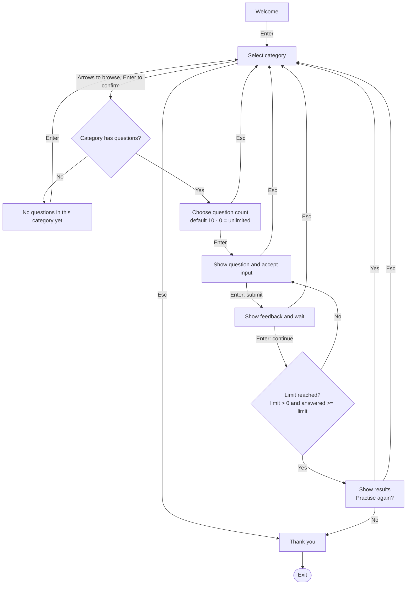
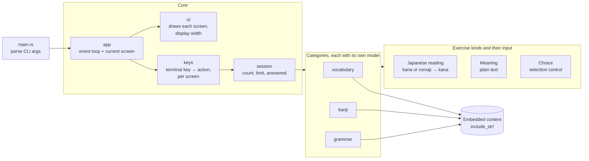

<!--
SPDX-License-Identifier: GPL-3.0-or-later
Copyright (C) 2026 PandaCubGames
-->

# Architecture (draft)

> **Status: planned.** None of this exists in code yet. These diagrams describe the
> intended design and will change as it gets built.

The diagrams use [Mermaid](https://mermaid.js.org/), which GitHub renders directly.
To edit one visually, paste its code into Excalidraw (*More tools → Mermaid to Excalidraw*).

## Core idea

The app is for **practice**. You pick a category (Grammar, Vocabulary or Kanji),
choose how many questions you want, and answer them one by one. Each answer gets
feedback, and at the end you see your results and can practise again.

## 1. Screen flow

Welcome and Thank you are ordinary screens at the start and the end. There is no
fixed header or footer, and no separate logout.

## 2. Decisions

### Scope
- **Practice only for now.** A broader study system (saved history, spaced repetition,
  detailed grading and explanation rules) is out of scope.

### Categories
- Vocabulary, kanji and grammar each have **their own model**.
- **Empty category:** it can still be selected. It shows "No questions in this category
  yet", and Enter goes back to category selection.

### Question count
- Chosen before practice starts. The default is `10`, and `0` means **unlimited**.
- Stored as a `u8`. Input is **clamped**, not rejected: anything above `255` becomes
  `255`, and anything below `0` becomes `0` (unlimited).
- The session ends when `limit > 0 && answered >= limit`. Unlimited mode never counts
  down, so an unsigned zero is never decremented.

### Answering and feedback
- **Input rules belong to the kind of exercise**, not to each exercise and not to one
  shared conversion step:
  - Japanese reading: accepts kana (from the user's IME) or romaji, converted to kana.
  - Meaning: plain text, never converted to kana.
  - Choice: picked with a selection control.
- Enter submits the answer. **Feedback is a waiting step:** it stays until the next Enter,
  including after the last question, before the results appear.
- Each submitted answer is **counted once**, correct or not. Continuing from feedback
  doesn't count it again.

### Keys
- Keys depend on the current screen:
  - Category selection: arrows and Enter.
  - Question: input suited to the exercise kind.
  - Feedback: waits for Enter.
- **Esc:**
  - While answering, on feedback, on the question count and on results: goes back to
    category selection. An unfinished answer is dropped and not counted as a mistake.
  - On category selection: goes to Thank you, then the app exits.
- **Practise again:** Yes goes back to category selection (so you can pick another
  category). No goes to Thank you, then exits.
- Terminal key handling is kept separate from session actions and drawing, so the
  screen changes can be tested without an interactive terminal.

## 3. Components

- `keys` turns a terminal key into an action for the current screen, and `session`
  applies it. Neither draws anything, so the flow can be unit tested.
- **Content** is embedded in the binary, so the release stays a single file. Sources and
  licenses go in `ATTRIBUTION.md`.

## 4. Still open

- The exact screens and data for each category's model.
- How grammar questions map onto the three exercise kinds.
